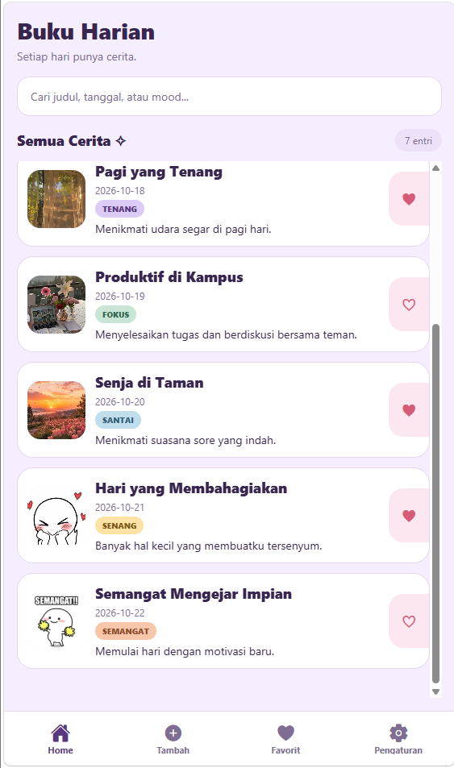
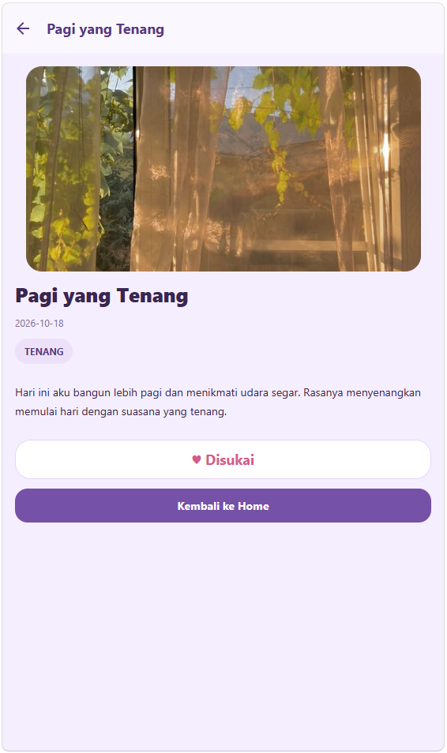
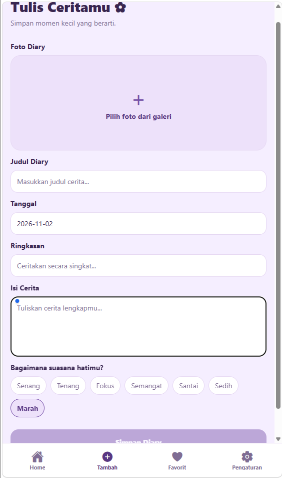
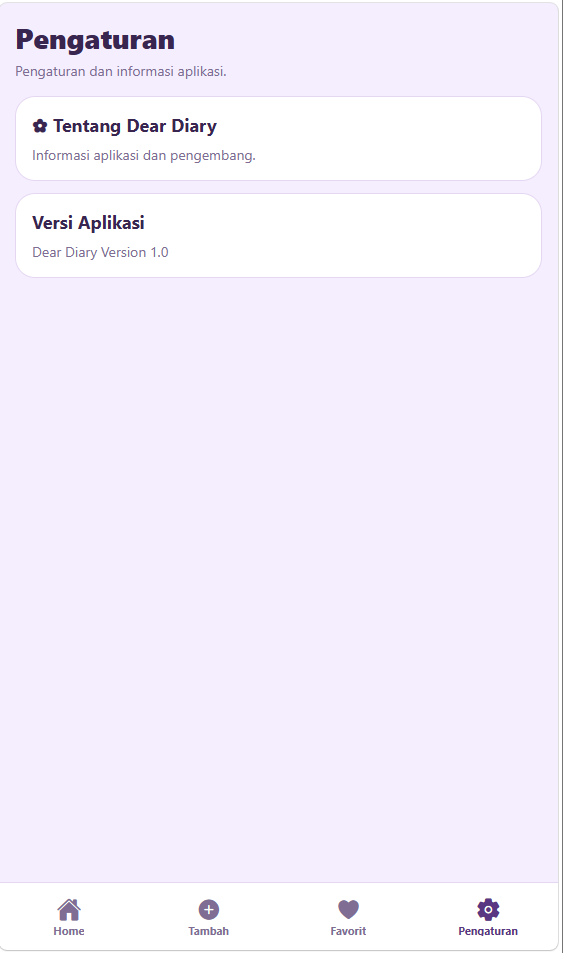
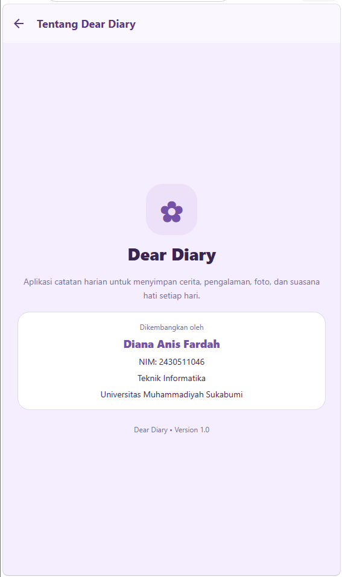

# Diary App – Praktikum 05

Aplikasi buku harian yang dikembangkan menggunakan React Native dan Expo CLI untuk Praktikum Pemrograman Mobile Pertemuan 5.

## Identitas Pengembang
- **Nama:** Diana Anis Fardah
- **NIM:** 2430511046
- **Program Studi:** Teknik Informatika
- **Universitas:** Universitas Muhammadiyah Sukabumi

## Fitur
- Home dan pencarian diary
- Tambah dan detail diary
- Favorit
- Pengaturan dan About
- Navigasi Stack dan Bottom Tabs
- Dynamic Route dan Route Parameters
- Context untuk shared state

## Screenshot Aplikasi

### Home


### Detail


### Tambah


### Favorit


### Pengaturan


### About


## Cara Menjalankan
```bash
npm install
npx expo start
```

**Teknologi:** React Native, Expo CLI, Expo Router, TypeScript.